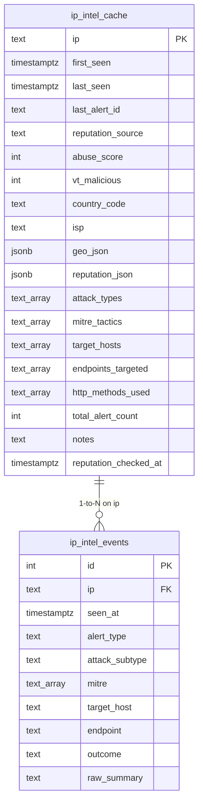

# Database Schema & Performance Specification

Database: **`abuseip`** (PostgreSQL 16)  
Access Model: **Read-Only Application Role**

---

## 1. Physical Schema Architecture

The database consists of two interrelated tables:
1. `ip_intel_cache` — Primary IP reputation, geolocation, and cumulative threat aggregation table.
2. `ip_intel_events` — Per-alert granular incident chronology table populated from Wazuh alerts.



---

## 2. Table Specifications & Discovered Metadata

### `ip_intel_cache`
- **Total Records (Discovered)**: ~465
- **Primary Key**: `ip` (`TEXT`)
- **Indexes**:
  - `ip_intel_cache_pkey` — `btree (ip)`
  - `idx_ip_intel_cache_last_seen` — `btree (last_seen)`
  - `idx_ip_intel_cache_rep_check` — `btree (reputation_checked_at)`

| Column Name | PostgreSQL Data Type | Nullable | Discovered Value Semantics |
| :--- | :--- | :---: | :--- |
| `ip` | `TEXT` | `NO` | IPv4 (e.g. `198.51.100.23`) or IPv6 address. |
| `first_seen` | `TIMESTAMPTZ` | `NO` | Defaults to `NOW()`. First time the IP triggered a security alert. |
| `last_seen` | `TIMESTAMPTZ` | `NO` | Defaults to `NOW()`. Most recent timestamp an alert arrived. |
| `last_alert_id` | `TEXT` | `YES` | Wazuh alert ID or case tracking ID. |
| `reputation_source` | `TEXT` | `YES` | `'abuseipdb'` (~90%) or `'virustotal'` (~10%). |
| `abuse_score` | `INTEGER` | `YES` | AbuseIPDB confidence score (0 to 100). |
| `vt_malicious` | `INTEGER` | `YES` | VirusTotal malicious analysis detections count. |
| `country_code` | `TEXT` | `YES` | ISO Alpha-2 code (e.g., `ID`, `US`, `CN`, `DE`, `NL`). |
| `isp` | `TEXT` | `YES` | ASN organization / ISP provider name. |
| `geo_json` | `JSONB` | `YES` | Object with `{ country, countryCode, isp, as }`. |
| `reputation_json` | `JSONB` | `YES` | Full raw API response payload from AbuseIPDB or VirusTotal v3. |
| `attack_types` | `TEXT[]` | `YES` | Attack categories: `'path_traversal'`, `'sql_injection'`, `'command_injection'`. |
| `mitre_tactics` | `TEXT[]` | `YES` | ATT&CK Technique IDs (e.g. `'T1595.002'`, `'T1498'`, `'T1055'`, `'T1083'`, `'T1190'`). |
| `target_hosts` | `TEXT[]` | `YES` | Wazuh agent names targeted (e.g. `'srv-web-01'`, `'db-prod'`). |
| `endpoints_targeted`| `TEXT[]` | `YES` | Target endpoints/URIs (up to 10 distinct per IP). |
| `http_methods_used` | `TEXT[]` | `YES` | HTTP methods: `'GET'`, `'POST'`, `'HEAD'`. |
| `total_alert_count` | `INTEGER` | `YES` | Defaults to `1`. Cumulative count of alerts associated with IP. |
| `notes` | `TEXT` | `YES` | Internal analyst notes / incident tag. |
| `reputation_checked_at` | `TIMESTAMPTZ` | `YES` | Cache freshness marker for the 7-day TTL expiration check. |

---

### `ip_intel_events`
- **Total Records (Discovered)**: ~573
- **Primary Key**: `id` (`SERIAL`)
- **Foreign Key**: `ip REFERENCES ip_intel_cache(ip) ON DELETE CASCADE`
- **Indexes**:
  - `ip_intel_events_pkey` — `btree (id)`
  - `idx_ip_intel_events_ip` — `btree (ip)`
  - `idx_ip_intel_events_seen_at` — `btree (seen_at)`

| Column Name | PostgreSQL Data Type | Nullable | Discovered Value Semantics |
| :--- | :--- | :---: | :--- |
| `id` | `INTEGER` | `NO` | Unique auto-incrementing serial sequence. |
| `ip` | `TEXT` | `NO` | Attacker IP referencing `ip_intel_cache.ip`. |
| `seen_at` | `TIMESTAMPTZ` | `NO` | Exact timestamp of the event. |
| `alert_type` | `TEXT` | `YES` | General alert type (`'attack'` 99.8%, `'system'` 0.2%). |
| `attack_subtype` | `TEXT` | `YES` | Specific vulnerability/attack category (`'path_traversal'`, `'sql_injection'`, `'command_injection'`). |
| `mitre` | `TEXT[]` | `YES` | Per-event MITRE ATT&CK technique IDs. |
| `target_host` | `TEXT` | `YES` | Host/agent where the alert triggered. |
| `endpoint` | `TEXT` | `YES` | HTTP request URI or affected service endpoint. |
| `outcome` | `TEXT` | `YES` | Attack outcome (e.g. `'blocked'`, `'failed'`, `'success'`). Currently `NULL` in legacy alerts. |
| `raw_summary` | `TEXT` | `YES` | Log line or Wazuh rule description snippet. |

---

## 3. Data Normalization & Value Mapping Plan

### A. MITRE ATT&CK Normalization
The database columns `ip_intel_cache.mitre_tactics` and `ip_intel_events.mitre` store technique/sub-technique IDs rather than tactic names.

The application maps technique IDs to enterprise MITRE tactics:
- **T1595 / T1595.002**: Active Scanning: Vulnerability Scanning $\rightarrow$ **Reconnaissance** (TA0043)
- **T1190**: Exploit Public-Facing Application $\rightarrow$ **Initial Access** (TA0001)
- **T1055**: Process Injection $\rightarrow$ **Defense Evasion** (TA0005) / **Privilege Escalation** (TA0004)
- **T1083**: File and Directory Discovery $\rightarrow$ **Discovery** (TA0007)
- **T1498**: Network Denial of Service $\rightarrow$ **Impact** (TA0040)

### B. Outcome Classification & Critical Alerting
Since historical events have `NULL` outcomes, the application classifies values into standardized groups:
1. **Critical / Compromised**:
   - Values: `'success'`, `'compromised'`, `'allowed'`, `'pwned'`, `'bypassed'`
   - Visual: Red badge `#ef4444` + Sticky critical warning banner on IP detail page hero.
2. **Defended / Mitigated**:
   - Values: `'blocked'`, `'denied'`, `'dropped'`, `'filtered'`, `'403'`
   - Visual: Emerald badge `#10b981`.
3. **Attempted / Failed**:
   - Values: `'failed'`, `'404'`, `'500'`
   - Visual: Amber/Zinc badge `#f59e0b`.
4. **Unknown / Unspecified**:
   - Values: `NULL`, `''`, `'unknown'`
   - Visual: Neutral slate badge `#64748b` (Treated as non-critical passive monitoring).

---

## 4. Query Analysis & Index Optimization Recommendations

> [!NOTE]
> Since the application operates with a **strictly read-only role**, these indexes are documentation recommendations for the database administrator (DBA) and must NOT be applied by the app.

### Recommended DBA Indexes:

```sql
-- 1. GIN index for fast array containment queries on attack_types
-- Useful for: WHERE attack_types @> ARRAY['sql_injection']
CREATE INDEX CONCURRENTLY IF NOT EXISTS idx_ip_intel_cache_attack_types_gin 
  ON ip_intel_cache USING gin (attack_types);

-- 2. GIN index for MITRE ATT&CK technique lookups
-- Useful for: WHERE mitre_tactics @> ARRAY['T1190']
CREATE INDEX CONCURRENTLY IF NOT EXISTS idx_ip_intel_cache_mitre_gin 
  ON ip_intel_cache USING gin (mitre_tactics);

-- 3. Composite B-tree index for global dashboard sorting
-- Speeds up: ORDER BY total_alert_count DESC, abuse_score DESC
CREATE INDEX CONCURRENTLY IF NOT EXISTS idx_ip_intel_cache_rank 
  ON ip_intel_cache (total_alert_count DESC, abuse_score DESC NULLS LAST);

-- 4. Composite B-tree index for paginated IP event logs
-- Speeds up: WHERE ip = $1 ORDER BY seen_at DESC LIMIT $2 OFFSET $3
CREATE INDEX CONCURRENTLY IF NOT EXISTS idx_ip_intel_events_ip_seen 
  ON ip_intel_events (ip, seen_at DESC);
```

### EXPLAIN Query Plan Notes:
- **IP Lookup (`WHERE ip = $1`)**: Hits `ip_intel_cache_pkey` with Index Scan, cost `< 0.28..8.30 ms`.
- **Top 10 Attackers (`ORDER BY total_alert_count DESC LIMIT 10`)**: On ~500 rows, in-memory QuickSort takes `< 1.2 ms`. With `idx_ip_intel_cache_rank`, switches to direct Index Scan with 0 sort cost.
- **Event History (`WHERE ip = $1 ORDER BY seen_at DESC`)**: Hits `idx_ip_intel_events_ip` with Bitmap Index Scan.
